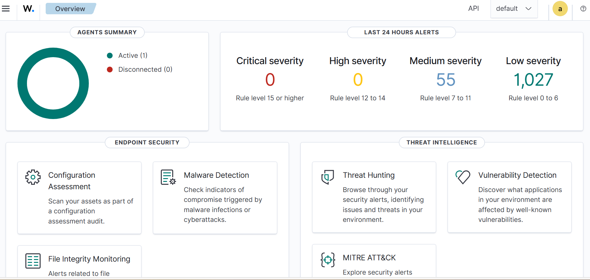

# Wazuh Homelab

## Overview

This project documents the implementation of a personal Wazuh SIEM environment for learning Security Engineering and DevSecOps.

## Objectives

- Learn SIEM fundamentals
- Learn log collection and analysis
- Implement security monitoring
- Build incident investigation skills
- Explore vulnerability management
- Implement security alerting

## Environment

### Hardware

| Component | Value |
|------------|------------|
| Device | Intel NUC |
| CPU | 4 vCPU |
| Memory | 16 GB RAM |
| Storage | 100 GB SSD |

### Operating System

| Item | Value |
|------------|------------|
| OS | Ubuntu Server |
| Hostname | ceker |
| Installation Date | 2026-10-19 |

## Components

- Wazuh Manager
- Wazuh Indexer
- Wazuh Dashboard

## Installation Progress

- [x] Environment preparation
- [x] Hardware validation
- [x] Download installer
- [x] Wazuh installation
- [x] Dashboard verification
- [x] Agent deployment
- [x] Alert configuration

## Notes

Project is currently under development.
``
=======
# Study Cases
- [ ] SSH Brute Force Detection
- [ ] File Integrity Monitoring
- [ ] Vulnerability Detection
- [ ] Active Response
- [ ] MITRE ATT&CK Analysis